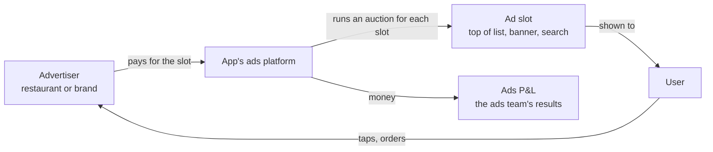

<!-- Generated from LEARN/_templates/01-ads-business.md by analysis/render_docs.py. Edit the template, not this file. -->
# 01 · The ads business in a delivery app
*10 minutes. No maths yet. Just the picture.*

## The simple idea
You open a food app. The first few restaurants you see are not always "the best". Some of them **paid**
to be there. That's ads. The app earns money from restaurants and brands who want more eyes on them.

**Example:** a new biryani place opens. Nobody knows it. It pays the app so it shows up in the top 3
for "biryani" searches near you. You see it, tap it, maybe order. The restaurant got a customer, the app got paid.

Hinglish: *Restaurant paisa deta hai taaki uska naam upar dikhe. App ko paisa milta hai, restaurant ko customer.*

## Who is involved

Three groups must stay happy:
1. **Advertisers**: if they don't get orders for their money, they stop paying.
2. **Users**: if ads make the app annoying, they order less. That hurts everything.
3. **The app**: wants ad revenue to grow.

The ads team's job is to grow revenue **without** breaking (1) or (2).

## Common ad formats in a delivery app
| Format | What it looks like | How it's usually charged |
|---|---|---|
| Sponsored listing | a restaurant shown higher in the list, marked "Ad" | per click (CPC) |
| Banner | a picture across the top or on the tracking screen | per 1,000 views (CPM) |
| Search ad | top result when you search "pizza" | per click |

## What the ads team does every week (from the JD)
- **KPI report**: how much did ads earn, and why did it move?
- **Auction health**: are prices set by real competition?
- **Opportunity sizing**: what would a new format or price change earn?
- **A/B tests**: did the change really work?
- **Advertiser insights**: who to grow, who is about to leave?

Each of these is one part of this project. Chapter 7 = KPI report, chapter 8 = auction + sizing,
chapter 9 = advertisers, chapter 10 = A/B tests.

## Important honesty point
This project does **not** use Swiggy data. Swiggy doesn't publish its ads data. I used public ad data
from an ad exchange (iPinYou, 2013) and from Criteo (an ad company). The *questions* are the ones a
delivery app's ads team asks; the *data* is a stand-in. Always say this first if asked.

## Check yourself
1. In one sentence, how does a food app make money from ads?
2. Name the three groups that must stay happy, and what goes wrong if each is unhappy.
3. What is the difference between paying per click and paying per 1,000 views?
4. Is this project's data from Swiggy? What do you say?

Answers

1. Restaurants and brands pay the app to show them more prominently, so more users see and order from them.
2. Advertisers (stop paying if no orders), users (order less if the app gets annoying), the app (needs revenue to grow).
3. Per click: the advertiser pays only when someone taps. Per 1,000 views (CPM): pays for being seen, tap or not.
4. No. "It's public ad data from iPinYou and Criteo; I analysed it the way a delivery app's ads team would."

