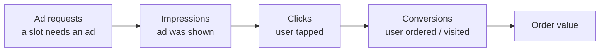

<!-- Generated from LEARN/_templates/02-ad-metrics.md by analysis/render_docs.py. Edit the template, not this file. -->
# 02 · Ad metrics, one by one
*20 minutes. This is the most asked part of any ads interview. Learn each one with its formula.*

## The funnel
Every ad metric is a step in this chain:

## Toy example (made-up numbers, so the maths is easy)
A restaurant runs ads for one day:
- 10,000 ad requests (slots that could show an ad)
- 8,000 impressions (ad actually shown)
- 200 clicks
- 20 orders, total order value ₹6,000
- The restaurant paid ₹1,600 in total

| Metric | Formula | Toy answer | Plain meaning |
|---|---|---|---|
| **Fill rate** | impressions / ad requests | 8,000 / 10,000 = 80% | how many slots we managed to sell |
| **CTR** (click-through rate) | clicks / impressions | 200 / 8,000 = 2.5% | how many who saw it, tapped |
| **CVR** (conversion rate) | conversions / clicks | 20 / 200 = 10% | how many who tapped, ordered |
| **CPM** (cost per mille) | spend / impressions × 1,000 | 1,600 / 8,000 × 1,000 = ₹200 | price of 1,000 views |
| **CPC** (cost per click) | spend / clicks | 1,600 / 200 = ₹8 | price of one tap |
| **CPA** (cost per acquisition) | spend / conversions | 1,600 / 20 = ₹80 | price of one order |
| **ROAS** (return on ad spend) | order value / spend | 6,000 / 1,600 = 3.75× | ₹ of orders per ₹1 of ads |
| **Win rate** | auctions won / bids made | (see chapter 3) | for a bidder: how often you win |

Hinglish: *CTR = kitne logon ne dekha aur tap kiya. CPA = ek order laane mein kitna kharcha hua.*

**Mille** is Latin for 1,000. That's why CPM is "per thousand".

## Ratio of totals, not average of ratios (very common trap)
**Toy:** Day 1: 100 clicks / 10,000 impressions (1%). Day 2: 1 click / 10 impressions (10%).
- Average of the two CTRs = (1% + 10%) / 2 = **5.5%**: wrong.
- Ratio of totals = 101 / 10,010 = **1.0%**: right.

Day 2 had almost no impressions, so it shouldn't count equally. In this project every ratio is
computed from totals. `tests/check_numbers.py` recomputes CTR, CPM and win rate from raw counts to make sure.

## Our real numbers (iPinYou, 2013-10-19 to 2013-10-28)
| Metric | Value | Note |
|---|---|---|
| Bids | 11,457,419 | auctions iPinYou entered |
| Won (impressions with a matching bid) | 4,704,705 | |
| Win rate | 41% | **stand-in for fill rate** |
| Impressions | 4,724,634 | |
| Revenue | 4,253.82 CNY | advertiser spend = marketplace ad revenue |
| CPM | 0.90 CNY | per 1,000 impressions |
| Clicks | 3,858 | |
| CTR | 0.082% | low, normal for display ads in 2013 |

## Two metrics we could NOT compute, and why
- **Fill rate** needs ad requests where *no* ad was shown. The logs only contain auctions iPinYou bid on.
  So I show **win rate** and call it a stand-in.
- **ROAS** needs order value. No dataset has it. So I show **CPA** (cost per conversion) instead.

Saying "I couldn't compute this, here's why, here's what I used instead" is a strength in an interview, not a weakness.

## Check yourself
1. An ad got 50,000 impressions and 400 clicks, and cost ₹10,000. What are CTR, CPM and CPC?
2. Why is averaging daily CTRs wrong?
3. What does fill rate need that our data doesn't have?
4. CPA is ₹50 and the average order is ₹300. What is ROAS if every conversion is one order?
5. What was our real CTR and CPM?

Answers

1. CTR = 400 / 50,000 = 0.8%. CPM = 10,000 / 50,000 × 1,000 = ₹200. CPC = 10,000 / 400 = ₹25.
2. Days with few impressions count as much as big days. Use total clicks / total impressions.
3. Ad requests that got no ad (unfilled requests). Our logs only show auctions iPinYou bid on.
4. ROAS = order value / spend = 300 / 50 = 6×.
5. CTR 0.082%, CPM 0.90 CNY per 1,000 impressions.

