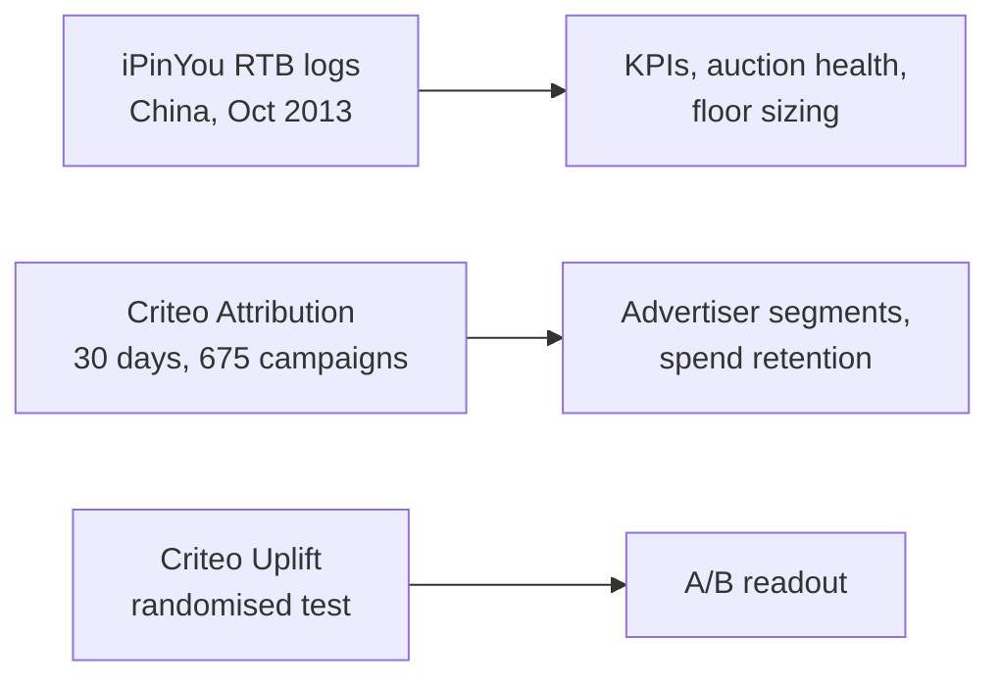

<!-- Generated from LEARN/_templates/04-datasets.md by analysis/render_docs.py. Edit the template, not this file. -->
# 04 · Our three datasets
*15 minutes. If an interviewer asks one thing, it's "where did the data come from?"*

## The three datasets and what each one is for

### 1. iPinYou real-time-bidding logs (season 3)
- **Who:** iPinYou, a Chinese ad-buying company, released these for a 2013 bidding competition.
- **What:** every auction it bid on: the slot, the floor price, its bid, and (if won) the price paid,
  plus clicks and conversions. 4 advertisers: milk powder, telecom, footwear, mobile app installs.
- **Size used:** 11,457,419 bids, 4,724,634 impressions after cleaning.
- **Money unit:** Chinese fen per 1,000 impressions (100 fen = 1 yuan). I converted to CNY.

### 2. Criteo Attribution dataset
- **Who:** Criteo AI Lab (Criteo is a big ad company). Licence CC BY-NC-SA 4.0 (free for non-commercial use, with credit).
- **What:** 16.47M ad impressions from 675 campaigns over 30 days, with cost, click, conversion.
- **Used as:** our "advertisers". Each campaign = one advertiser.
- **Catch:** cost is "a transformed version" of the real price, so I only compare campaigns with each other.

### 3. Criteo Uplift dataset (v2.1)
- **What:** 13,979,592 users, randomly split into treatment (could see ads) and control (could not).
  For each user: did they visit, did they convert, were they actually exposed to an ad.
- **Used as:** a real A/B test to read out (chapter 10).

## Cleaning I did, and why (good interview material)
| Problem found | What I did |
|---|---|
| Raw files were huge text files (GBs) | converted to Parquet once, deleted the raw files (chapter 6) |
| Some impressions appeared twice | kept one row per auction ID |
| Win rate dropped by half mid-week | iPinYou had cut its test set out of the logs; I added the public part back |
| A second test part was never released | totals after Oct 21 are **lower bounds**; ratios are still fair because the split was random |
| Row counts | checked every file: Parquet rows = raw lines; Criteo counts = published counts |

Hinglish: *Jab koi number achanak bahut badal jaye, pehle data pe shak karo, market pe baad mein.*

## What the data cannot tell us
- **Fill rate** (no unfilled requests) → win rate as stand-in.
- **ROAS** (no order value) → CPA as stand-in.
- **Rupee amounts** → real units only (CNY, transformed Criteo cost).
- **Real categories** in Criteo (they're hashed codes) → I never gave them made-up names.
- **Advertiser churn** → Criteo's sample keeps almost every campaign active all month, so I measured shrinking spend instead.

## Check yourself
1. Which dataset did you use for the A/B test, and why that one?
2. What unit are iPinYou prices in?
3. Why are totals after Oct 21 "lower bounds" but ratios still fair?
4. Why can't you put a ₹ sign on these numbers?

Answers

1. Criteo Uplift, because users were randomly assigned to treatment and control, which is what a real A/B test needs.
2. Chinese fen (0.01 yuan) per 1,000 impressions.
3. iPinYou withheld a random part of the impressions. Missing rows lower the totals, but a random sample keeps ratios like CTR and CPM unbiased.
4. The data is in 2013 Chinese currency and a transformed Criteo unit, not rupees. A ₹ sign would be a false claim.

