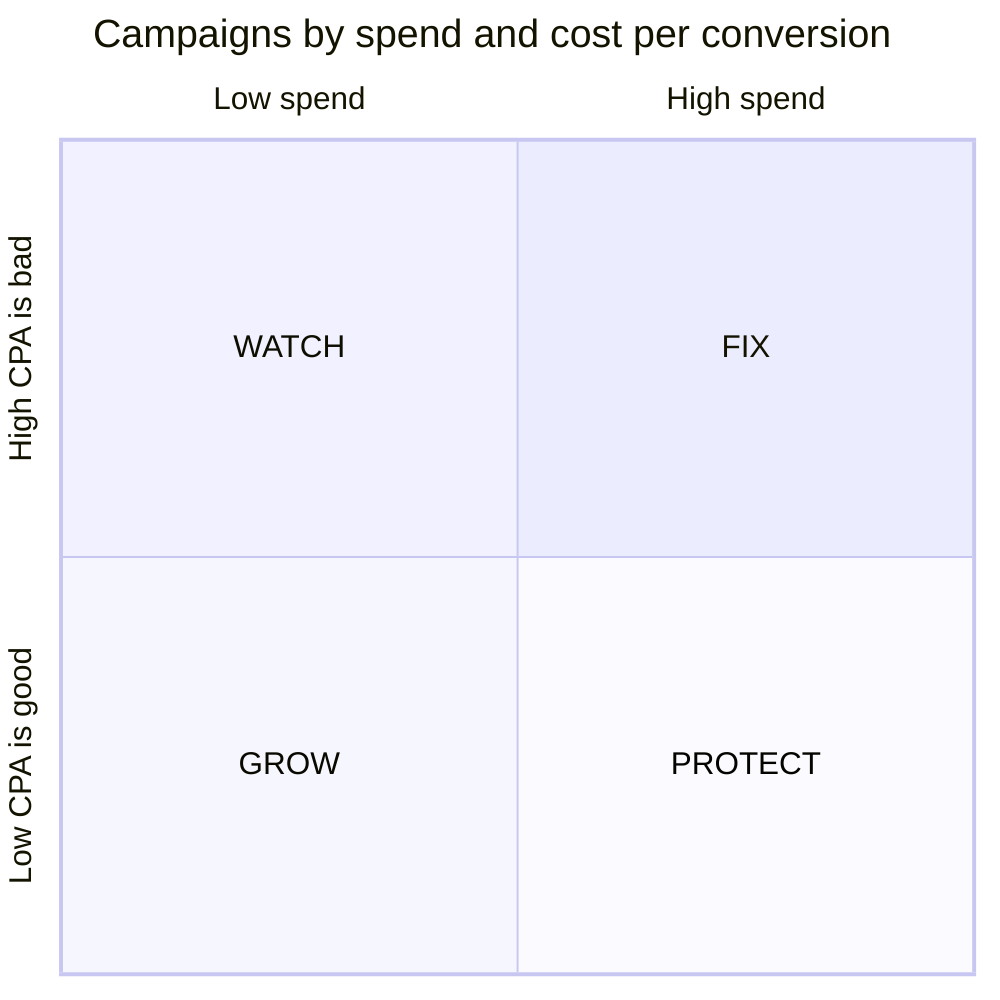

<!-- Generated from LEARN/_templates/09-advertiser-segments.md by analysis/render_docs.py. Edit the template, not this file. -->
# 09 · Advertiser segments and spend retention
*15 minutes. "Which advertisers to grow, which to fix": straight from the JD.*

## The data
675 Criteo campaigns over 30 days. Each campaign = one advertiser. For each: spend, clicks, conversions.
Cost is a transformed unit, so we compare campaigns with **each other**, never in rupees.

## Step 1: how concentrated is spend?
Sort campaigns from biggest to smallest spend and add up a running share (a running total, chapter 5).
- Top 10% of campaigns: **59%** of spend
- Top 20%: **73%** of spend

Close to the famous 80/20 rule. Meaning: losing a few big advertisers hurts a lot. Watch them closely.

## Step 2: two simple cuts → four groups
Cut 1: spend above or below the **median**. Cut 2: **CPA** (cost per conversion) above or below the median.
Low CPA = efficient (cheap conversions).

| Group | Rule | What ad sales should do |
|---|---|---|
| **PROTECT** | high spend, low CPA | big and happy: keep them, upsell |
| **FIX** | high spend, high CPA | paying a lot per conversion: improve targeting/bids before they cut spend |
| **GROW** | low spend, low CPA | efficient but small: pitch more budget |
| **WATCH** | low spend, high CPA | low priority |

Why the median? It splits campaigns into halves and isn't pulled around by a few giant campaigns (an average would be).

## Step 3: real results (`outputs/segment_summary.csv`)
| Group | Campaigns | Share of spend | CPA | Spend week 4 ÷ week 1 |
|---|---|---|---|---|
| PROTECT | 143 | 48% | 0.0070 | 107% |
| FIX | 195 | 44% | 0.0332 | 97% |
| GROW | 195 | 4% | 0.0048 | 98% |
| WATCH | 142 | 4% | 0.0352 | 94% |

The headline: **FIX holds 44% of spend but pays 4.7× as much per conversion as PROTECT**, and its spend is
already shrinking (97% of week 1). GROW converts 31% cheaper than PROTECT on only 4% of spend.
78 campaigns in total cut their spend by more than half from week 1 to week 4: that's the "call them now" list.

Hinglish: *FIX wale advertiser bahut paisa de rahe hain par har order unhe mehenga pad raha hai. Agar humne madad nahi ki, woh chale jaayenge.*

## Step 4: why "spend retention" and not churn?
My plan was churn cohorts (how many advertisers stop each week). But in Criteo's sample about 98% of campaigns
are active every single day, because the sample was built that way. Churn would look like zero, which is meaningless.
So I measured **spend retention** = week-4 spend ÷ week-1 spend for the same campaigns. Like "net revenue retention" in SaaS.

This is a good interview story: "My first plan didn't fit the data, so I changed the metric and wrote down why."

## The SQL ideas used (`sql/05_campaign_segments.sql`)
- `median(spend)` in a CTE called `cut`, then `CROSS JOIN cut` to compare every campaign with it
- `CASE WHEN ... THEN 'PROTECT' ...` for labels
- `sum(spend) OVER (ORDER BY spend_rank)` for the running share
- `GROUP BY ROLLUP (segment)` for the total row (`sql/06`)

## Check yourself
1. Why split at the median and not the average?
2. Which group would you call first, and why?
3. Why didn't you measure churn?
4. What does a spend retention of 97% mean?

Answers

1. The median isn't pulled by a few huge campaigns; it gives two equal halves.
2. FIX: a big share of spend, expensive conversions, and spend already falling. Highest risk of losing revenue.
3. In this sample almost every campaign stays active all month, so churn would show nothing; spend retention still moves.
4. In week 4 these campaigns spent 97% of what they spent in week 1: they are pulling back.

