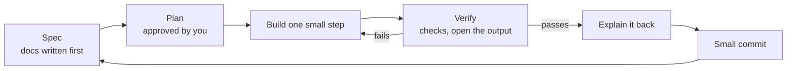

<!-- Generated from LEARN/_templates/12-how-this-was-built-with-claude-code.md by analysis/render_docs.py. Edit the template, not this file. -->
# 12 · How this was built with Claude Code
*15 minutes. For you to become a pro AI-assisted builder. (Keep AI-tool names OFF the resume bullets; this is for your own skill.)*

## The big idea
An expert doesn't say "AI, build me a project". They **direct, constrain and verify**: write the plan, set rules,
make repeat work one command, and check every output. The AI types; you stay the analyst.

Hinglish: *AI se kaam karwao, par plan aur checking tumhare haath mein rehni chahiye.*

## The loop used for every step

## The pieces, and where they live in this project
| Pro habit | Here | Why it matters |
|---|---|---|
| **Plan before code** | `docs/BUILD-PLAN.md`, approved before any download | cheap to change a plan, costly to change code |
| **Design docs first** | PRD, DATA, ARCHITECTURE, METRICS, EXPERIMENT, ADRs | the AI builds toward a written target |
| **CLAUDE.md** (local, not committed) | rules every session reads: no fake numbers, numbers only from numbers.json, Mac memory limits, commit rules | a new session behaves the same without re-explaining |
| **Slash commands** (`.claude/commands/`) | `/rebuild` runs the pipeline, `/check` runs the tie-outs, `/explain <file>` teaches a file | repeat work = one word |
| **Hooks** | git `pre-commit` blocks data/secrets; `commit-msg` blocks attribution lines; a Claude hook blocks `--no-verify` | rules enforced by code, not memory |
| **Single source of truth** | `outputs/numbers.json`; docs rendered from templates | no number can drift between memo, Excel, dashboard and resume |
| **Pre-registration** | `docs/EXPERIMENT.md` before the A/B readout | the AI (and you) can't "find" a result after the fact |
| **Second-opinion agent** | a fresh agent re-derived the A/B maths from raw counts only | caught an implausible estimate |
| **Background jobs** | downloads and conversions ran in the background, one at a time | 8 GB Mac stayed usable |
| **Decision records (ADRs)** | `docs/adr/`, e.g. 0004 superseded by 0007 | a changed decision is visible, not silently swapped |

## The things that went wrong (and how the system caught them)
1. **Wrong model assumption.** The first floor model trusted iPinYou's bids. Reading the dataset README showed the bids were
   fixed and high. Fix: new ADR, new model. *Lesson: read the data's documentation before modelling.*
2. **A metric halved overnight.** Win rate dropped mid-week. Cause: a test set was cut out of the logs. Found by comparing row
   counts with the README. *Lesson: when a number jumps, suspect the data first.*
3. **A too-good-to-be-true estimate.** The second agent flagged the "effect on exposed users". *Lesson: get a second opinion on the riskiest maths.*
4. **A sum that changed between runs.** Parallel addition gave tiny float differences, so `numbers.json` changed with no real change.
   Fix: round to 10 significant figures. *Lesson: make outputs reproducible.*
5. **A unit slip in a guesstimate** (₹4.8M written as ₹4.8 crore). Caught by re-running the arithmetic. *Lesson: compute, don't eyeball.*

## How YOU check AI work (use this every time)
1. Did the checks actually run? Look at the real output, not "should work".
2. Does every number trace back to a query or `numbers.json`?
3. Did a join change the row count unexpectedly?
4. Is any ratio averaged instead of computed from totals?
5. Can you explain the change in one minute? If not, run `/explain <file>` first.

**Red flags:** numbers with no query behind them · a test changed in the same commit as the code it checks ·
"about" numbers never computed · a metric renamed to sound better than it is.

## A good prompt has 6 parts
| Part | Example from this project |
|---|---|
| Goal | "Write `sql/04_floor_sizing.sql`" |
| Context | "Model in ADR 0007, tables in `sql/00_views.sql`" |
| Constraints | "DuckDB, 3 GB memory, CTEs with plain-English comments" |
| Acceptance | "At X = 0, revenue equals actual revenue for every exchange" |
| Verify | "Run `tests/check_numbers.py` and show the output" |
| Output | "Explain in 5 lines + 2 check questions" |

## Check yourself
1. Why write EXPERIMENT.md before the readout?
2. What does the pre-commit hook stop?
3. Why render the memo from a template instead of typing numbers?
4. Name one mistake the checks caught.

Answers

1. So the decision rule can't be bent to fit the result.
2. Committing data files, secrets, CLAUDE.md or the .claude folder.
3. So every number comes from numbers.json; a check fails if someone types a number by hand.
4. Any of: the fixed-bid assumption, the missing test impressions, the implausible exposed-user effect, the float drift, the lakh/crore slip.

