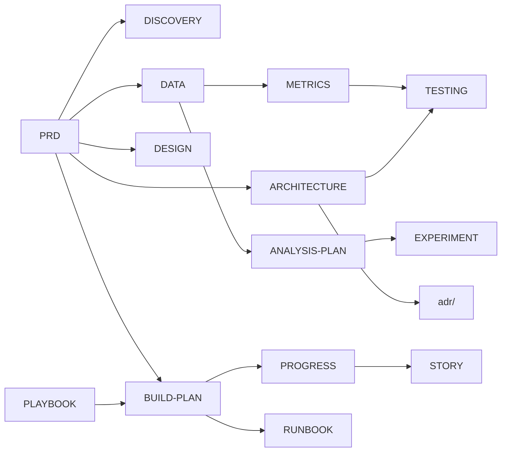
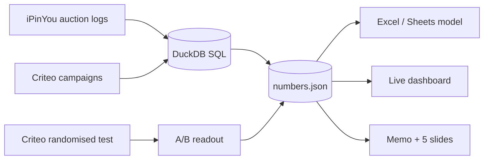

# Docs — read these before any code

**One line:** ads analytics for a delivery marketplace, built on public ad data: KPI reporting, auction
health, floor-price sizing, advertiser segments and a real A/B test readout.

**New here? Start with [STORY.md](STORY.md)**, the whole project in simple words. The detailed *how*
of each step is in [PROGRESS.md](PROGRESS.md). To learn it from zero, go to [`../LEARN/`](../LEARN/00-START-HERE.md).

## Reading order

| # | File | What it answers | Time |
|---|---|---|---|
| 1 | [PRD.md](PRD.md) | The problem, users, goals, scope, JD coverage | 10 min |
| 2 | [DISCOVERY.md](DISCOVERY.md) | How a marketplace ads business works; what the team tracks | 8 min |
| 3 | [DATA.md](DATA.md) | The 3 datasets: source, licence, schema, limits, what's not computable | 12 min |
| 4 | [ARCHITECTURE.md](ARCHITECTURE.md) | How numbers flow: raw → Parquet → SQL → numbers.json → outputs | 10 min |
| 5 | [adr/](adr/README.md) | Why each big choice was made (6 one-page decisions) | 12 min |
| 6 | [METRICS.md](METRICS.md) | Every metric's formula, unit and edge cases | 10 min |
| 7 | [ANALYSIS-PLAN.md](ANALYSIS-PLAN.md) | The 8 questions and my guesses before looking | 5 min |
| 8 | [EXPERIMENT.md](EXPERIMENT.md) | A/B design written before the readout | 10 min |
| 9 | [TESTING.md](TESTING.md) | How I know the numbers are right (reconciliations) | 8 min |
| 10 | [DESIGN.md](DESIGN.md) | Dashboard look, tokens, chart rules | 8 min |
| 11 | [BUILD-PLAN.md](BUILD-PLAN.md) | Phases, checks, cut order | 10 min |
| 12 | [RUNBOOK.md](RUNBOOK.md) | Rebuild from scratch, Sheets import, deploy | 5 min |
| 13 | [CLAUDE-CODE-PLAYBOOK.md](CLAUDE-CODE-PLAYBOOK.md) | How the agent was directed and checked | 10 min |
| 14 | [DECISIONS.md](DECISIONS.md) | Plain list of choices and what I dropped | 3 min |

For leadership: [MEMO.md](MEMO.md) (1-page memo) · [WALKTHROUGH.md](WALKTHROUGH.md) (2-minute spoken script) · `READOUT.pptx` (5 slides, after P9). MEMO, STORY, WALKTHROUGH and the root README are rendered from `_templates/` so their numbers always match `outputs/numbers.json`.
Also: [`../CONTRIBUTING.md`](../CONTRIBUTING.md). The agent's working rules live in a local `CLAUDE.md` that is not committed.

## How the docs connect

## The project on one page

*Status 2026-10-24: analysis, Excel and dashboard built; all checks pass (`python run_all.py`).*
