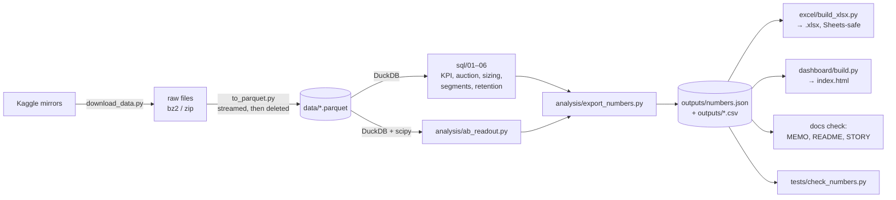
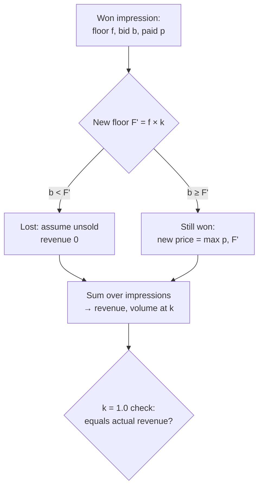

# ARCHITECTURE — how the numbers flow

## 1. The pipeline



**One rule:** `outputs/numbers.json` is the only place numbers come from. Excel, dashboard, memo,
slides and resume bullets all read it. `run_all.py` runs every box above in order.

## 2. Tables (DuckDB views over Parquet)

```mermaid
erDiagram
    IPY_BIDS ||--o| IPY_IMPS : "BidID (won)"
    IPY_IMPS ||--o{ IPY_CLICKS : BidID
    IPY_IMPS ||--o{ IPY_CONVS : BidID
    IPY_BIDS { string bid_id PK; timestamp ts; int exchange; int floor_price; int bid_price; int advertiser_id; string slot_format }
    IPY_IMPS { string bid_id PK; int pay_price }
    CRITEO_ATTR { bigint ts; string uid; int campaign; int click; int conversion; double cost; double cpo }
    CRITEO_UPLIFT { int treatment; int exposure; int visit; int conversion; double f0_f11 }
```

## 3. Query layer

| File | Question | Output |
|---|---|---|
| `sql/01_kpi_daily.sql` | KPIs per day | `kpi_daily.csv` |
| `sql/02_kpi_advertiser.sql` | KPIs per advertiser, exchange, slot | `kpi_advertiser.csv` |
| `sql/03_auction_health.sql` | bid vs pay, floor binding rate, win rate | `auction_health.csv` |
| `sql/04_floor_sizing.sql` | revenue/volume at floor × {1.0…2.0} | `floor_sizing.csv` |
| `sql/05_segments.sql` | campaign spend tiers × CPA quadrant | `segments.csv` |
| `sql/06_retention.sql` | campaign weekly retention cohorts | `retention.csv` |
| `analysis/ab_readout.py` | lift, CI, p, SRM, MDE, CACE | `ab_readout.json` |

## 4. Floor-price sizing logic (detail in ADR 0004)



## 5. Runtime limits
DuckDB `memory_limit='3GB'`, `threads=4`; one heavy query at a time; Parquet with ZSTD compression.
Dashboard is static HTML + one JSON file; no server. Deployed on Vercel as static files.
