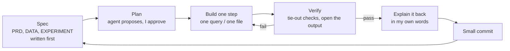
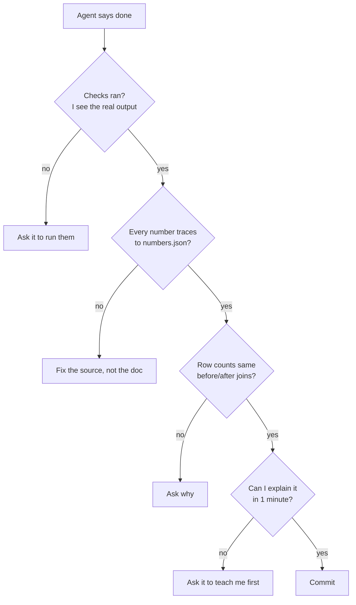

# CLAUDE CODE PLAYBOOK — how this project was built with an AI agent
*The skill isn't typing prompts. It's **directing, constraining and verifying**. This file is updated as features are actually set up; ⏳ = planned.*

## 1. The loop

## 2. Setup used here

| Feature | How it's used in this project | Status |
|---|---|---|
| **Plan first** | BUILD-PLAN.md approved before any download | Done |
| **CLAUDE.md** | local rules file: honesty, numbers only from `numbers.json`, 8 GB limits, commit rules | Done |
| **Pre-registration** | EXPERIMENT.md written before the A/B readout, so the agent can't "find" a result | Done |
| **Slash commands** (`.claude/commands/`) | `/rebuild` (run pipeline), `/check` (tie-outs), `/explain <file>` (teach a file simply) | Done |
| **Hooks** (`.claude/settings.json`) | before `git commit`: block data files, secrets, attribution lines | Done |
| **Subagent review** | a fresh agent gets only the raw counts and re-derives A/B lift, CI, SRM; must match | Done (matched to 6 s.f., raised 4 caveats) |
| **Background jobs** | downloads and Parquet conversion run in background, one at a time | Done |
| **Browser check** | headless Chrome render + screenshots (desktop, 390 px frame); the in-app preview server was blocked, so this route was used | Done |
| **Parallel sessions** | a separate Resume session fits the bullets; this session only builds | Done |

## 3. A good prompt (6 parts), with an example from this project

| Part | Example |
|---|---|
| Goal | "Write `sql/04_floor_sizing.sql`" |
| Context | "Logic in ADR 0004 and ARCHITECTURE §4" |
| Constraints | "DuckDB, 3 GB memory, CTEs with plain-English comments" |
| Acceptance | "At k = 1.0 revenue equals actual revenue exactly" |
| Verify | "Run `tests/check_numbers.py`, show the output" |
| Output | "Explain in 5 lines + 2 check questions" |

## 4. How I check the agent's work

**Red flags:** a number with no query behind it · "should be about…" without running · averaging ratios ·
a test changed in the same commit as the code · a metric renamed to sound better than it is.

## 5. What actually happened (lessons)
- **The agent's first floor model was wrong, and the docs caught it.** Reading the iPinYou README showed bids were fixed. A written ADR made the change visible (0004 → 0007) instead of silently swapping code.
- **A metric jump was a data problem.** Win rate halving mid-week came from a removed test set. Checking row counts against the README found it.
- **The second-opinion agent paid for itself.** It matched every number and flagged an implausible estimate I would otherwise have quoted.
- **Hooks did their job.** The pre-commit hook blocked a test data file; the Bash guard blocked `--no-verify`.
