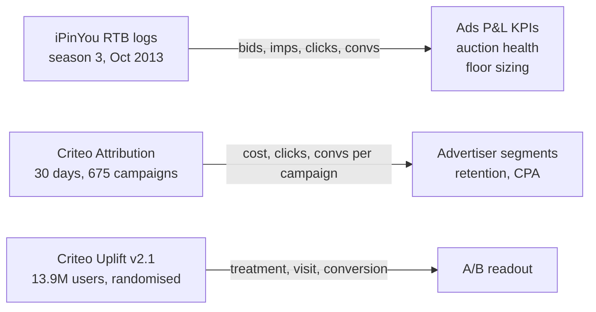

# DATA — sources, licences, schemas, limits
*Every fact marked ✅ is checked against the downloaded files in phase P1; ⏳ means not yet checked.*

## 1. The three datasets

| | iPinYou RTB (season 3) | Criteo Attribution | Criteo Uplift v2.1 |
|---|---|---|---|
| Publisher | iPinYou (Chinese DSP), for its 2013 bidding contest | Criteo AI Lab | Criteo AI Lab |
| Paper | Zhang et al. 2014, *Real-Time Bidding Benchmarking with iPinYou Dataset* (arXiv:1407.7073) | Diemert et al. 2017, *Attribution Modeling Increases Efficiency of Bidding in Display Advertising* | Diemert et al. 2018, *A Large Scale Benchmark for Uplift Modeling* |
| Where I get it | Kaggle mirror `lastsummer/ipinyou` (`training3rd/`) | Kaggle mirror `sharatsachin/criteo-attribution-modeling` | Kaggle mirror `arashnic/uplift-modeling` |
| Licence | Research use per iPinYou README ⏳ | CC BY-NC-SA 4.0 ⏳ | CC BY-NC-SA 4.0 ⏳ |
| Download | ~880 MB bz2 (bid ~650 MB, imp ~220 MB, clk/conv small) | ~670 MB zip → 2.6 GB TSV | ~340 MB zip → 3.2 GB CSV |
| Rows (published) | to count ⏳ | 16,468,027 impressions ⏳ | 13,979,592 ⏳ |

Licence line for the README: *Non-commercial, educational analysis; datasets credited to iPinYou and
Criteo AI Lab under their published terms. No raw data is redistributed in this repo.*

## 2. Schemas (fields I use)

**iPinYou** (tab-separated, no header; season 2/3 format ⏳):

| Field | Meaning | Used for |
|---|---|---|
| `BidID`, `Timestamp` | one auction, time `yyyyMMddHHmmssSSS` | join bids ↔ imps; daily KPIs |
| `AdExchange` | which exchange sent the request (1–3, anonymised) | win rate / CPM by exchange |
| `AdSlotWidth`, `AdSlotHeight`, `AdSlotVisibility`, `AdSlotFormat` | the ad slot | inventory segments |
| `AdSlotFloorPrice` | the floor (reserve) price for this slot | auction health, sizing |
| `BiddingPrice` | what iPinYou bid | bid vs price paid |
| `PayingPrice` (imp log only) | price actually paid when won | revenue, CPM |
| `AdvertiserID` | 4 advertisers in season 3 | per-advertiser KPIs |
| clk / conv logs | one row per click / conversion, keyed by `BidID` | CTR, CVR, CPA |

Prices: CNY fen (0.01 yuan) per 1,000 impressions ⏳ (confirm from README/paper).

**Criteo Attribution** (TSV with header): `timestamp`, `uid`, `campaign`, `conversion`, `conversion_timestamp`,
`conversion_id`, `attribution`, `click`, `click_pos`, `click_nb`, `cost`, `cpo`, `time_since_last_click`, `cat1`–`cat9` ⏳.
`cost` = price paid for the impression (scaled); `cpo` = cost per order for the campaign (scaled).

**Criteo Uplift** (CSV with header): `f0`–`f11` (anonymised user features), `treatment` (1 = in the ad group),
`conversion`, `visit`, `exposure` (1 = actually saw an ad) ⏳.

## 3. Processing
Raw → Parquet once, streamed, then raw deleted (ADR 0001). iPinYou bz2 is decompressed with `bzcat`
in a pipe, one file at a time. No sampling unless a step runs out of memory; if I sample, it's stated here
with the seed and fraction.

## 4. What this data CANNOT tell us
| Wanted (JD) | Why not | What I show instead |
|---|---|---|
| **Fill rate** | needs requests where no ad was served; logs only contain requests iPinYou bid on | **win rate** = won imps / bids (bidder's view), labelled as such |
| **ROAS** | no order value in any dataset | **CPA** (cost per conversion) |
| Advertiser count trends at scale | iPinYou: 4 advertisers | Criteo: 675 campaigns as the advertiser proxy |
| Rupee revenue | 2013 CNY fen; Criteo scaled | real units; ₹ only as "illustrative, assumes X" |
| Other bidders' bids | logs show iPinYou's bid only | sizing assumes a lost impression stays unsold (conservative) — ADR 0004 |
| Categories (food, grocery…) | features are hashed (`cat1`–`cat9`) | "segment" = hashed category value, never renamed to a real category |
