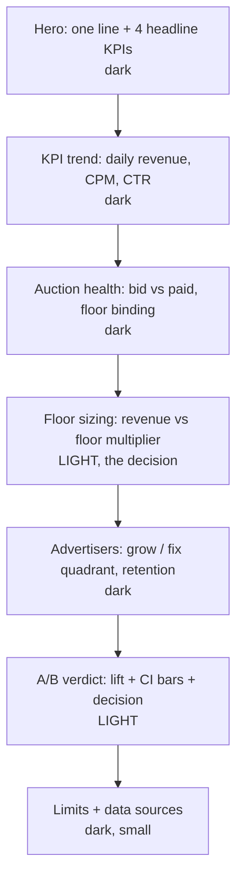

# DESIGN — the dashboard's look
*Goal: looks hand-designed by someone who reads the numbers, not like a generated template.
Tokens are provisional until the P7 build; chart colours get validated with a contrast check.*

## 1. Principles
1. **Headline number first**, then the chart that explains it, then the caveat. Every section answers one question.
2. **Dark premium base, inverted light sections** for the "decision" parts (sizing, A/B verdict), so the page has rhythm.
3. **Type does the work**: big serif numerals, quiet sans text, mono for tables.
4. **Motion is subtle**: elements rise 12 px and fade in once on scroll; off when `prefers-reduced-motion`.
5. **Own brand** ("Slotwise", working name). No Swiggy logo, no Swiggy orange, nothing that reads as an official Swiggy page.

**Never:** default Tailwind/shadcn card grids, purple/blue gradients, glassmorphism, emoji, drop-shadow stacks, 3D charts, pie charts with > 3 slices.

## 2. Page structure



## 3. Tokens (provisional)
```css
:root {
  --ink:      #0F1113;  /* dark base */
  --ink-2:    #171A1D;  /* raised dark surface */
  --paper:    #F4F1EA;  /* light sections */
  --text-hi:  #F4F1EA;  --text-lo: #9AA0A6;     /* on dark */
  --text-ink: #121416;  --text-ink-lo: #5B6168; /* on light */
  --accent:   #2E9E83;  /* teal-green: one accent, used for "the number to look at" */
  --warn:     #D4A72C;  /* caveats, stand-in labels */
  --neg:      #D0574B;  /* negative deltas only */
  --rule:     rgba(244,241,234,.12);
  --font-display: "Newsreader", Georgia, serif;
  --font-text:    "IBM Plex Sans", system-ui, sans-serif;
  --font-mono:    "IBM Plex Mono", ui-monospace, monospace;
  --step-hero: clamp(2.6rem, 6vw, 4.8rem);
  --space: 8px; /* multiples only */
}
```

## 4. Charts
- One categorical palette for all charts (max 4 series), sequential ramp of the accent for single-series.
- Every axis labelled with its unit ("CPM, CNY fen per 1,000 imps"); numbers as 1.2K / 3.4M.
- Direct labels over legends where possible; gridlines faint; no chart junk.
- Stand-in metrics carry a small `--warn` "stand-in" tag with a tooltip linking METRICS.md.
- Works at 360 px wide: charts stack, tables scroll inside their own box, never the page.

## 5. Checks before shipping
Contrast AA on both dark and light sections · no console errors · 360 px and 1440 px screenshots · reduced-motion on.
