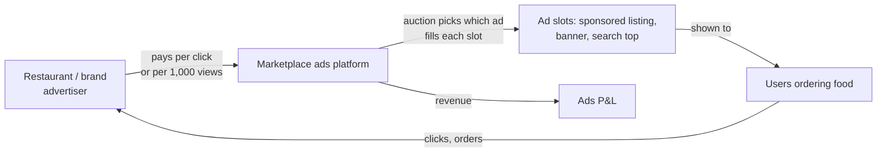

# DISCOVERY — what a marketplace ads team tracks, and why
*No interviews with Swiggy staff were done. This is built from the JD and public material about how
marketplace/retail-media ads work. Sources are listed in §4; any claim not backed by a source is
labelled as my understanding.*

## 1. How a delivery app makes money from ads (my understanding)

Two sides to keep healthy: **advertisers** (get orders for their spend, or they leave) and **users**
(ads must not make the app worse, or orders drop). The ads team's job is growing revenue without
breaking either side.

## 2. What the team watches, and why

| Area | Metrics | Why it matters |
|---|---|---|
| Revenue | ad revenue, CPM, CPC | the P&L line |
| Demand | advertiser count, spend per advertiser, retention | revenue concentration risk; churn |
| Supply | fill rate, inventory utilisation | unsold slots = lost revenue |
| Auction | win rate, floor binding, bid density | weak competition → low prices |
| Advertiser outcome | CTR, CVR, CPA, ROAS | if advertisers don't see return, they cut spend |
| User guardrails | order conversion, session length, organic clicks | ads must not hurt the core business |

## 3. JD → deliverable map
See [PRD.md §6](PRD.md#6-jd-coverage).

## 4. Sources
_Collected and checked in P8; nothing is cited until I've read it._
- The Swiggy Ads BA Intern JD (pasted by Pranay, Oct 2026).
- iPinYou dataset paper (Zhang et al. 2014) for RTB auction mechanics.
- IAB / ad-server documentation for standard metric definitions (CPM, fill rate) ⏳.
- Public Swiggy filings / reports mentioning advertising income ⏳ (only if found and read).
