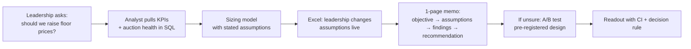

# PRD — ads analytics for a delivery marketplace
*What I build and why. No code here.*

## 1. The problem
A food-delivery app sells ad slots to restaurants and brands: "sponsored" listings, banners, top-of-search
placements. Every week the ads team has to answer the same questions, fast and with numbers it trusts:

1. How much did ads earn, and why did it move? (revenue, CPM, CTR, advertiser count)
2. Is the auction healthy? Are prices set by real competition or by the floor price?
3. What would a pricing change earn before we ship it? (floor price, new format, new placement)
4. Which advertisers should we grow, and which are at risk of leaving?
5. Did the experiment work, and is the result real or noise?

**Problem in one sentence:** *Ads leadership needs one trusted, repeatable view of the ads P&L plus
sized answers to pricing and experiment questions, and the numbers must reconcile everywhere they appear.*

## 2. Users

| User | Needs | What they get here |
|---|---|---|
| **Ads leadership** (head of ads, category leads) | One page, the headline number first, a clear recommendation | MEMO.md, 5-slide readout, dashboard top section |
| **Ads analyst** (the BA intern) | Reproducible SQL, metric definitions, a model to change assumptions | `sql/`, METRICS.md, Excel model |
| **Ads sales / account managers** | Which advertisers to call: grow, fix, win back | Segment table, retention cohorts |

## 3. Journey

## 4. Goals and success metrics

| Goal | How I'll know it's met |
|---|---|
| KPIs are correct | tie-outs pass: daily sums = overall; SQL = Excel = dashboard (TESTING.md) |
| Sizing model is trustworthy | at today's floor it reproduces today's revenue exactly |
| A/B readout is honest | design written before results; SRM check; CI and MDE reported |
| Leadership can act on it | memo fits one page and ends with one recommendation |
| Pranay can defend it | can explain every query and number without notes (local study notes) |

## 5. Scope
**In:** KPI layer, auction health, floor-price sizing, advertiser segmentation + retention, A/B readout,
Excel/Sheets model, static dashboard, memo, slides, metric definitions.

**Out (and why):**
- Real-time pipeline / scheduling: one-off public data, nothing to refresh live.
- Machine-learning models (CTR prediction, bidding): not what a BA role tests.
- BI tools (Tableau, Power BI, Looker): ADR 0003.
- Fill rate and ROAS: data can't support them (DATA.md §4).

## 6. JD coverage

| JD must-have | Deliverable |
|---|---|
| Advertiser performance, ad revenue, inventory utilisation, auction health | `sql/01–03`, dashboard |
| Opportunity sizing (formats, pricing, placements) | floor sizing model, guesstimate drills |
| A/B test design and readouts for leadership | EXPERIMENT.md + readout + memo |
| Advertiser and category insights (spend, ROI, retention, grow/fix) | `sql/05–06` |
| Recurring KPI reporting with metric definitions | KPI layer + METRICS.md + dashboard |
| Strong SQL on large datasets | DuckDB over tens of millions of rows |
| Advanced Excel / Google Sheets | Excel model, Sheets-compatible |
| Clear communication to senior stakeholders | MEMO, READOUT slides, WALKTHROUGH script |
