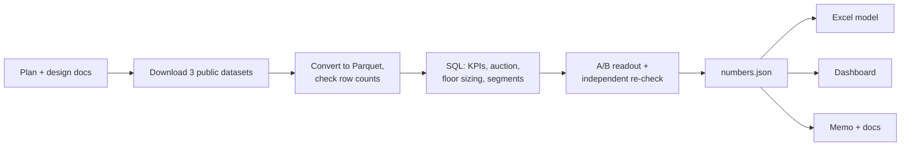

<!-- Generated from docs/_templates/STORY.md by analysis/render_docs.py. Edit the template, not this file. -->
# The story
*The whole project in simple words, in my voice. This is also what I say in interviews.*

> **Where we are (2026-10-24):** everything is built, checked and live: https://slotwise-ads.vercel.app · code: https://github.com/Zakuroooo/ads-analytics. LEARN course and practice set written.

## 1. Why I built it
I'm applying to the Swiggy Ads team as a business analyst intern. I didn't want to just say "I know SQL
and A/B testing". I wanted to do the real work of an ads analyst, on real data, and be able to show it.

## 2. The problem in one line
Every week an ads team has to know how ads are earning, whether the auction is healthy, what a price
change would earn, which advertisers to grow, and whether an experiment really worked.

## 3. What I did, step by step

1. **Plan first.** I wrote the problem, the data plan, the metric definitions and the A/B decision rule before touching data.
2. **Data.** 11,457,419 auction bids and 4,724,634 impressions from iPinYou (2013), 16.47M impressions across 675 Criteo campaigns, and a randomised test on 13,979,592 users. Every file's row count was checked.
3. **KPI layer.** Revenue 4,254 CNY, CPM 0.90 CNY, CTR 0.082%, win rate 41%. Daily and per-advertiser totals add up to the overall totals exactly.
4. **Auction health.** Where a floor exists it decided the price 37% of the time. One exchange had no floors at all.
5. **Floor sizing.** A minimum floor of 30 fen only pays off if at least 51% of at-risk impressions still sell.
6. **Advertisers.** Four groups by spend and cost per conversion. The "fix" group pays 4.7× more per conversion on 44% of spend.
7. **A/B readout.** Conversion +59% (95% CI +54% to +65%), decision SHIP, checked by an independent re-derivation.

## 4. Five ideas I must be able to explain
1. **CPM** = revenue for 1,000 impressions. Ours: 0.90 CNY.
2. **Floor price** = the lowest price the seller accepts. In a second-price auction, if no rival bids above the floor, the floor *is* the price.
3. **Break-even retention** = the share of at-risk impressions that must still sell for a higher floor to pay off. It turns an unknown into a clear test target.
4. **Confidence interval** = the range the true lift probably sits in. Ours, +54% to +65%, is far from zero, so the lift is real.
5. **Ratio of totals, not average of ratios.** Overall CTR = total clicks / total impressions. Averaging daily CTRs gives the wrong answer when days differ in size.

## 5. Mistakes and what they taught
- **Trusting the bids.** My first floor model treated iPinYou's bids as advertiser value. The README said the bids were fixed and high. I replaced the model with a break-even version. Lesson: read the data's documentation before modelling.
- **Missing impressions.** Win rate roughly halved halfway through the logs. It wasn't the market; iPinYou had removed its test set. Lesson: when a metric jumps, suspect the data first.
- **An effect that was too good.** The "effect on exposed users" came out implausibly big. An independent re-check flagged it, so I kept it out of the decision. Lesson: get a second pair of eyes on the riskiest maths.
