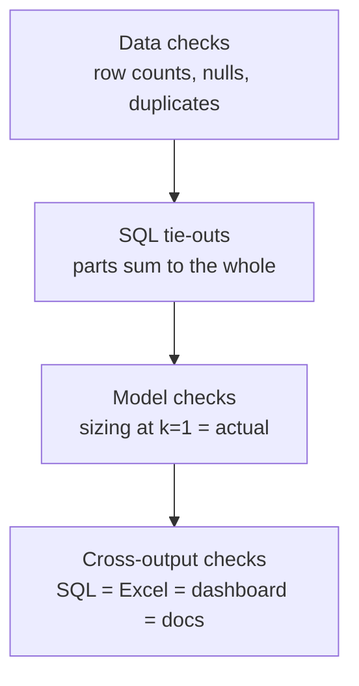

# TESTING — how I know the numbers are right
*Rule: nothing is "done" until `python tests/check_numbers.py` passes and its real output is pasted in PROGRESS.md.*

Analytics bugs don't crash; they give a wrong number quietly. So the tests are **reconciliations**:
the same number computed two different ways must match.

## 1. Check layers

## 2. The checks

| # | Check | Pass condition |
|---|---|---|
| D1 | Row counts after Parquet conversion | equal raw line counts; Criteo counts equal published counts (DATA.md) |
| D2 | Duplicate keys | 0 duplicate `BidID` in imps (or counted and removed, logged) |
| D3 | Price sanity | no negative prices; share of paid > bid reported (should be ~0 in a second-price auction) |
| S1 | Daily vs overall | Σ daily revenue/imps/clicks = overall totals exactly |
| S2 | Per-advertiser vs overall | Σ advertiser revenue = overall revenue |
| S3 | Ratios recomputed | CTR, CPM, CPA from `numbers.json` = recomputed in Python from raw counts (to 1e-9) |
| S4 | Segments | 4 groups' campaigns sum to 675, spend shares to 100%, conversions and spend to the Criteo totals |
| M1 | Floor sizing at X = 0 | lower = upper = actual revenue for every exchange; actual = KPI spend |
| M2 | Sizing monotonic | as X rises, at-risk impressions never fall and the lower bound never rises |
| M3 | A/B maths | my z-test p-value and CI match scipy / statsmodels within 1e-6 |
| M4 | A/B independent review | a fresh reviewer agent re-derives lift, CI, SRM from counts only; results match |
| X1 | Excel totals | the `formulas` engine recalculates the `.xlsx`; 21 key cells = `numbers.json` (`tests/check_excel.py`) |
| X2 | Docs | README/MEMO/STORY/WALKTHROUGH are rendered from templates; rendered = fresh render, templates have no hand-typed % (`tests/check_docs.py`) |
| X3 | Dashboard | headless Chrome renders every section from `data.js` (built from `numbers.json`); screenshots at 1440 px and in a 390 px frame |

## 3. Red flags when reviewing AI-written analysis
A number with no query behind it · a check edited in the same commit as the code it checks ·
ratios averaged instead of recomputed from totals (average of daily CTRs ≠ overall CTR) ·
joins that silently multiply rows (always compare row counts before and after a join).

## 4. Status (2026-10-24)
`python run_all.py` runs everything: 29/29 tie-outs (S1–S4, M1–M3) · 21/21 Excel cells (X1) · 8/8 docs checks (X2).
M4 done once by an independent agent from raw counts: all A/B numbers matched to 6 significant figures (EXPERIMENT.md §8).

**LEARN chapters** are rendered from `LEARN/_templates/` with the same values, so their real numbers always match.
They are left out of the hand-typed-percentage scan because their toy examples (made-up 3-row tables) need typed numbers;
toy numbers are always labelled "toy".
