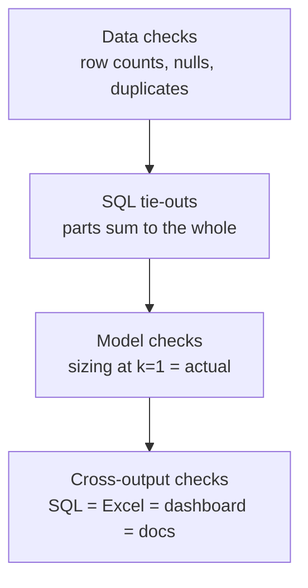

# TESTING — how I know the numbers are right
*Rule: nothing is "done" until `python tests/check_numbers.py` passes and its real output is pasted in PROGRESS.md.*

Analytics bugs don't crash; they give a wrong number quietly. So the tests are **reconciliations**:
the same number computed two different ways must match.

## 1. Check layers

## 2. The checks

| # | Check | Pass condition |
|---|---|---|
| D1 | Row counts after Parquet conversion | equal raw line counts; Criteo counts equal published counts (DATA.md) |
| D2 | Duplicate keys | 0 duplicate `BidID` in imps (or counted and removed, logged) |
| D3 | Price sanity | no negative prices; share of paid > bid reported (should be ~0 in a second-price auction) |
| S1 | Daily vs overall | Σ daily revenue/imps/clicks = overall totals exactly |
| S2 | Per-advertiser vs overall | Σ advertiser revenue = overall revenue |
| S3 | Ratios recomputed | CTR, CPM, CPA from `numbers.json` = recomputed in Python from raw counts (to 1e-9) |
| S4 | Segment shares | 4 quadrants' spend shares sum to 100% |
| S5 | Retention | week-0 retention = 100% for every cohort |
| M1 | Floor sizing at k = 1.0 | revenue = actual revenue exactly; volume = actual imps |
| M2 | Sizing monotonic volume | impressions never increase as k rises |
| M3 | A/B maths | my z-test p-value and CI match scipy / statsmodels within 1e-6 |
| M4 | A/B independent review | a fresh reviewer agent re-derives lift, CI, SRM from counts only; results match |
| X1 | Excel totals | totals recomputed from the `.xlsx` values = `numbers.json` |
| X2 | Docs | every number in README/MEMO/STORY/WALKTHROUGH exists in `numbers.json` (regex scan) |
| X3 | Dashboard | page loads, no console errors, headline KPIs = `numbers.json` |

## 3. Red flags when reviewing AI-written analysis
A number with no query behind it · a check edited in the same commit as the code it checks ·
ratios averaged instead of recomputed from totals (average of daily CTRs ≠ overall CTR) ·
joins that silently multiply rows (always compare row counts before and after a join).
