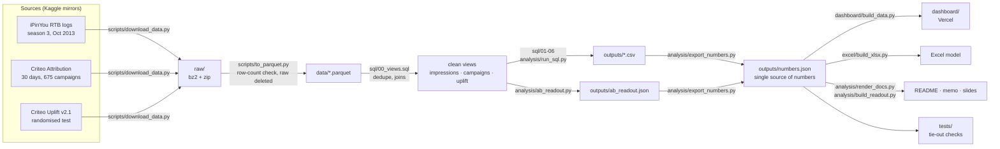

# Slotwise: ads funnel, auction and A/B analytics

**SQL and statistics on real public ad logs ({bids} bids, {criteo_impressions} campaign impressions, a {ab_users}-user randomised test) that answer the questions a marketplace ads team asks every week: how revenue moves, whether the auction is healthy, what a price change would earn, which advertisers to grow, and whether a new ad treatment worked.**

[](https://slotwise-ads.vercel.app)


*Built on public ad data (iPinYou, Criteo). Not Swiggy data, no Swiggy users.*

## Live dashboard

**https://slotwise-ads.vercel.app** · single static page, works on a phone, every number read from the SQL outputs.

[](https://slotwise-ads.vercel.app)

Also in the repo: an [Excel / Google Sheets model](excel/ads_kpi_model.xlsx) with live formulas, a [1-page memo](docs/MEMO.md) and a [5-slide leadership readout](docs/READOUT.pptx).

## The business question

A food-delivery marketplace sells sponsored listings to restaurants and brands. Its ads team has to answer five questions:

1. **How is the ads business doing?** Revenue, impressions, CPM and click-through, every day.
2. **Is the auction healthy?** Is the price set by real competition, or only by the floor (reserve) price?
3. **What would a minimum floor price earn?** And what has to be true for it to pay off?
4. **Which advertisers should sales grow, protect or fix?** Who spends a lot but pays too much per conversion?
5. **Did a new ad treatment actually work?** A randomised test with a decision rule fixed in advance.

**Who uses the answers:** the ads monetisation / pricing team (floor price), ad-sales and account managers (which advertisers to call), the experimentation team (ship or not), and leadership (the weekly KPI view). Marketplace ad logs are not public, so the analysis uses three real public ad datasets as stand-ins (see [Limitations](#limitations)).

## Key findings

Every value below is filled in from `outputs/numbers.json` by `analysis/render_docs.py`; nothing is typed by hand (`tests/check_docs.py` fails if this README drifts from the outputs).

| Question | Finding | Value | Source |
|---|---|---|---|
| Ads P&L | Ad revenue, {first_day} to {last_day} | **{revenue} CNY** from {impressions_full} impressions | [`outputs/numbers.json`](outputs/numbers.json) → `ipinyou_kpi` |
| Ads P&L | Daily CPM range | {cpm_min} to {cpm_max} CNY per 1,000 impressions: revenue moved with volume, not price | [`outputs/kpi_daily.csv`](outputs/kpi_daily.csv) |
| Ads P&L | Click-through rate · win rate | {ctr} · {win_rate} | [`outputs/numbers.json`](outputs/numbers.json) → `ipinyou_kpi` |
| Auction health | Floor set the price (impressions that have a floor) | **{floor_binding}** | [`outputs/auction_health.csv`](outputs/auction_health.csv) |
| Auction health | Impressions sold on exchange {no_floor_exchange}, which has no floor at all | {no_floor_share} | [`outputs/auction_health.csv`](outputs/auction_health.csv) |
| Floor sizing | Minimum floor of 30 fen CPM: impressions at risk | {x30_at_risk} | [`outputs/floor_sizing.csv`](outputs/floor_sizing.csv) |
| Floor sizing | Revenue change, none vs all at-risk impressions still sell | {x30_lower} to {x30_upper} | [`outputs/floor_sizing.csv`](outputs/floor_sizing.csv) |
| Floor sizing | Break-even: share of at-risk impressions that must still sell | **{x30_breakeven}** | [`outputs/floor_sizing.csv`](outputs/floor_sizing.csv) |
| Advertisers | Spend held by the top 20% of {campaigns} campaigns | {top20_share} | [`outputs/campaign_segments.csv`](outputs/campaign_segments.csv) |
| Advertisers | "Fix" group: share of spend · CPA vs "protect" group · week-4 spend vs week 1 | {fix_share} · **{fix_cpa_ratio}** · {fix_retention} | [`outputs/segment_summary.csv`](outputs/segment_summary.csv) |
| A/B test | Conversion rate, control → treatment ({ab_users_full} users) | {conv_c} → {conv_t} | [`outputs/ab_readout.json`](outputs/ab_readout.json) |
| A/B test | Relative lift (95% CI) · p-value | **{conv_rel}** ({conv_rel_lo} to {conv_rel_hi}) · p = {conv_p} | [`outputs/ab_readout.json`](outputs/ab_readout.json) |
| A/B test | Decision under the pre-registered rule | **{decision}** | [`outputs/ab_readout.json`](outputs/ab_readout.json) |

## Screenshots

Captured with Playwright (headless Chromium) from the [`dashboard/`](dashboard/) folder that Vercel deploys on every push to `main`. Desktop at 1440×900, mobile at 390 px wide.

| Ads P&L, day by day | Auction health |
|---|---|
|  |  |
| **Floor-price sizing (interactive)** | **Advertiser segments** |
|  |  |
| **A/B test readout** | **Mobile (390 px)** |
|  |  |

## Data pipeline



`run_all.py` runs every step from `sql/` onwards in order and stops at the first failure. `data/` and `raw/` are never committed; the small aggregated `outputs/` are.

## Schema and metric definitions

Tables and views defined in [`sql/00_views.sql`](sql/00_views.sql). `IMPRESSIONS` is a view: training impressions plus the public leaderboard test impressions, one row per `bid_id`, with clicks and conversions joined on.

```mermaid
erDiagram
    ADVERTISERS ||--o{{ BIDS : "bids for"
    BIDS ||--o| IMPRESSIONS : "won as"
    IMPRESSIONS ||--o{{ CLICKS : "gets"
    IMPRESSIONS ||--o| CONVS : "converts as"
    CAMPAIGNS ||--|{{ ATTRIBUTION : "aggregates"

    ADVERTISERS {{
        int advertiser_id PK
        varchar category
    }}
    BIDS {{
        varchar bid_id PK
        timestamp ts
        int exchange
        varchar slot_visibility
        int floor_price "fen per 1,000 imps"
        int bid_price
        int advertiser_id FK
    }}
    IMPRESSIONS {{
        varchar bid_id PK
        timestamp ts
        int exchange
        int floor_price
        int pay_price "price paid, fen per 1,000 imps"
        int clicks
        int conversion
        varchar source "train or test"
    }}
    CLICKS {{
        varchar bid_id FK
        timestamp ts
    }}
    CONVS {{
        varchar bid_id FK
        timestamp ts
    }}
    ATTRIBUTION {{
        int timestamp "seconds from window start"
        int campaign FK
        int click
        int attribution "last-touch conversion"
        float cost "transformed unit"
    }}
    CAMPAIGNS {{
        int campaign PK
        bigint impressions
        bigint clicks
        bigint conversions
        float spend
        float spend_w1
        float spend_w4
    }}
    UPLIFT {{
        int treatment "1 = eligible for ads"
        int exposure "1 = actually saw an ad"
        int visit
        int conversion
        float f0_to_f11 "anonymised features"
    }}
```

**Funnel (iPinYou, {first_day} to {last_day}):** {bids} bids → {bids_won} bids won → {impressions_full} impressions → {clicks} clicks → {conversions} conversions. Impressions exceed bids won because some impressions have no matching bid; they count in the KPIs but not in the win rate. iPinYou logged conversions (landing-page visits) for only 2 of its 4 advertisers.

| Metric | Definition | SQL / code |
|---|---|---|
| Win rate *(stand-in for fill rate)* | bids won / bids | [`01_kpi_daily.sql`](sql/01_kpi_daily.sql), [`02_kpi_advertiser.sql`](sql/02_kpi_advertiser.sql), [`03_auction_health.sql`](sql/03_auction_health.sql) |
| Revenue · CPM | Σ `pay_price` / 100,000 (CNY) · revenue × 1,000 / impressions | [`01_kpi_daily.sql`](sql/01_kpi_daily.sql), [`02_kpi_advertiser.sql`](sql/02_kpi_advertiser.sql) |
| CTR | clicks / impressions, always from totals (never an average of daily ratios) | [`01_kpi_daily.sql`](sql/01_kpi_daily.sql), [`02_kpi_advertiser.sql`](sql/02_kpi_advertiser.sql), [`05_campaign_segments.sql`](sql/05_campaign_segments.sql) |
| CVR | conversions / clicks (NULL where conversions aren't tracked) | [`02_kpi_advertiser.sql`](sql/02_kpi_advertiser.sql), [`06_segment_summary.sql`](sql/06_segment_summary.sql) |
| CPA *(stand-in for ROAS)* | spend / conversions | [`02_kpi_advertiser.sql`](sql/02_kpi_advertiser.sql), [`05_campaign_segments.sql`](sql/05_campaign_segments.sql), [`06_segment_summary.sql`](sql/06_segment_summary.sql) |
| Floor-binding rate | among impressions with a floor: share where price paid ≤ floor | [`03_auction_health.sql`](sql/03_auction_health.sql) |
| Floor sizing | new floor = max(current floor, X); revenue if none / half / all at-risk impressions still sell, and the break-even share | [`04_floor_sizing.sql`](sql/04_floor_sizing.sql) |
| Segment | spend above/below median × CPA below/above median → PROTECT / FIX / GROW / WATCH | [`05_campaign_segments.sql`](sql/05_campaign_segments.sql) |
| Spend retention | week-4 spend / week-1 spend, same campaigns | [`06_segment_summary.sql`](sql/06_segment_summary.sql) |
| A/B lift, CI, p-value, SRM, MDE | see the next section | [`analysis/ab_readout.py`](analysis/ab_readout.py) |

Full definitions and edge cases: [`docs/METRICS.md`](docs/METRICS.md).

## A/B test method

- **Question:** does making users eligible to see ads raise the share who convert?
- **Design:** Criteo's randomised test. {users_t} treatment users were eligible for ads, {users_c} control users were not.
- **Hypotheses:** H0, conversion rate is the same in both groups; H1, it differs (two-sided).
- **Decision rule, committed before the analysis code existed** ([`docs/EXPERIMENT.md`](docs/EXPERIMENT.md)): ship if the sample-ratio check passes, the conversion-lift 95% CI is above zero, and visits don't fall.
- **Tests used:**
  - two-proportion z-test (pooled standard error) for the p-value;
  - Wald 95% CI (unpooled) for the absolute lift, and a log-ratio (delta method) CI for the relative lift;
  - chi-square sample-ratio-mismatch check against the intended 85/15 split;
  - minimum detectable effect at α = 0.05 and 80 percent power.
  - p-values and CIs are cross-checked against statsmodels in the tie-out tests.
- **Result:**

| | Control | Treatment | Lift (95% CI) | p-value |
|---|---|---|---|---|
| Conversion (primary) | {conv_c} | {conv_t} | {conv_abs} ({conv_abs_lo} to {conv_abs_hi} pp) · {conv_rel} relative ({conv_rel_lo} to {conv_rel_hi}) | {conv_p} |
| Visit (guardrail) | {visit_c} | {visit_t} | {visit_rel} relative | < 1e-300 (underflows to 0) |

  Sample ratio: treatment share {srm_share} (p = {srm_p}), so it passes. The smallest lift this test could reliably detect is {mde_conv}, far below the observed effect. **Decision: {decision}.**
- **What I don't use:** the "effect on users who actually saw an ad" divides the lift by the exposure rate ({exposure}) and gives an implausibly large number, so it is reported but not used for the decision.

## Tech stack

| Part | Tool | Why |
|---|---|---|
| Data | Kaggle CLI, Parquet (zstd) | public mirrors of the three datasets; columnar files let queries read only the columns they need ([ADR 0001](docs/adr/0001-duckdb-parquet-over-pandas.md)) |
| SQL / analysis | DuckDB SQL (CTEs, window functions, `GROUPING SETS`, `FILTER`) | analyses tens of millions of rows on a laptop with no database server |
| Statistics | SciPy, statsmodels | z-test, chi-square and normal quantiles in SciPy; statsmodels as an independent cross-check |
| Spreadsheet | openpyxl, `formulas` | builds an Excel / Google Sheets model with live formulas (SUMIFS, XLOOKUP, NORM.S.INV); `formulas` recalculates it in tests |
| Dashboard | static HTML + hand-built SVG charts (no chart library), Vercel | opens instantly on a phone, no server to keep awake, reads one generated data file ([ADR 0003](docs/adr/0003-static-dashboard-over-bi-tool.md)) |
| Reporting | python-pptx, Markdown templates | slides and docs are rendered from `numbers.json`, so no number is typed by hand ([ADR 0006](docs/adr/0006-numbers-json-single-source.md)) |
| Testing | plain Python reconciliation scripts | analytics bugs give wrong numbers instead of crashing, so each check computes a number two ways and compares |
| CI / deploy | `run_all.py` locally, git hooks, Vercel | no hosted CI yet; hooks block data, secrets and attribution lines; Vercel redeploys `dashboard/` on every push to `main` |

## Project structure

```
ads-analytics/
├── sql/            00_views.sql + 6 numbered queries (KPIs, auction, floor sizing, segments)
├── analysis/       run_sql.py, ab_readout.py, export_numbers.py, render_docs.py, build_readout.py
├── outputs/        query results (CSV), ab_readout.json, numbers.json: the committed numbers
├── dashboard/      index.html + data.js (generated), deployed to Vercel
├── excel/          build_xlsx.py + ads_kpi_model.xlsx
├── tests/          check_numbers.py, check_excel.py, check_docs.py
├── scripts/        download_data.py, to_parquet.py, githooks/
├── docs/           PRD, data, metrics, experiment, memo, ADRs, images, templates
└── run_all.py      one command: SQL → A/B → numbers.json → Excel → dashboard → docs → checks
```

## Getting started

Needs Python 3.12+ and, for a full rebuild, a Kaggle API token in `~/.kaggle` and about 6 GB of free disk.

```bash
git clone https://github.com/Zakuroooo/ads-analytics && cd ads-analytics
python3 -m venv .venv && source .venv/bin/activate
pip install -r requirements.txt
git config core.hooksPath scripts/githooks      # optional: blocks data/secrets in commits
```

**Check the committed numbers (no download needed).** These read only `outputs/` and the Excel file:

```bash
python tests/check_numbers.py    # 29 tie-out checks
python tests/check_excel.py      # recalculates the workbook, compares 21 cells
python tests/check_docs.py       # README / memo / story / walkthrough match numbers.json
```

**Rebuild everything from raw data:**

```bash
python scripts/download_data.py      # iPinYou + Criteo from Kaggle
python scripts/to_parquet.py         # converts to data/*.parquet, checks row counts, deletes raw files
python run_all.py                    # SQL → A/B → numbers.json → Excel → dashboard → docs → checks
```

Note: `scripts/to_parquet.py` also expects the iPinYou leaderboard test file (`leaderboard.test.data.20131021_28.txt.bz2`) under `raw/ipinyou/`, which `download_data.py` does not fetch yet. Details and troubleshooting: [`docs/RUNBOOK.md`](docs/RUNBOOK.md).

## Data-quality checks and tests

`run_all.py` ends with three test scripts. Current result: **29/29 tie-outs, 21/21 Excel cells, 8/8 docs checks pass.**

| Check | What must match | Script |
|---|---|---|
| Row counts | each Parquet file = its raw file's line count; Criteo files = published counts ({criteo_impressions} attribution rows, {ab_users_full} uplift users) | `scripts/to_parquet.py` |
| Duplicates | duplicated `bid_id`s in the impression logs are collapsed to one row with `ROW_NUMBER` | `sql/00_views.sql` |
| S1 daily vs overall | daily bids, wins, impressions, clicks, conversions and spend add up to totals computed by a separate query | `tests/check_numbers.py` |
| S2 advertisers / auction | advertiser and auction-health totals equal the KPI totals; spend shares sum to 1 | `tests/check_numbers.py` |
| S3 ratios | CPM, CTR and win rate recomputed from raw counts (to 1e-9) | `tests/check_numbers.py` |
| S4 segments | the 4 segments partition all {campaigns} campaigns; spend and conversions sum to the Criteo totals | `tests/check_numbers.py` |
| M1–M2 floor model | at X = 0 the model reproduces today's revenue on every exchange; at-risk impressions never fall as X rises | `tests/check_numbers.py` |
| M3 A/B maths | p-values and CIs equal statsmodels' | `tests/check_numbers.py` |
| X1 Excel | the workbook is recalculated by a formula engine; 21 key cells equal `numbers.json` | `tests/check_excel.py` |
| X2 docs | every rendered doc equals a fresh render; templates contain no hand-typed percentages | `tests/check_docs.py` |

More: [`docs/TESTING.md`](docs/TESTING.md), [`docs/DATA.md`](docs/DATA.md).

## Limitations

- **Real data, not marketplace data.** The datasets are real public ad logs (a Chinese DSP in 2013, and Criteo's display ads), not a food-delivery marketplace. Findings show the method; the values would differ on real marketplace data. Money is 2013 CNY for iPinYou; Criteo's `cost` is a transformed unit, so Criteo campaigns are only compared with each other.
- **Fill rate can't be computed.** It needs ad requests that went unfilled, which no public log has. Win rate is shown instead, labelled as a stand-in.
- **ROAS can't be computed.** No dataset has order value, so CPA is used.
- **iPinYou's bids aren't real valuations.** Its campaigns used a fixed high bid, so the floor model uses only prices paid plus a break-even share ([ADR 0007](docs/adr/0007-floor-sizing-minimum-floor-break-even.md)). The share of at-risk impressions that would still sell is unknown; the model shows a range, not a forecast.
- **Some impressions are missing.** iPinYou withheld a reserved test set that was never released, so totals after Oct 21 are lower bounds. Ratios stay fair because the split was random.
- **Advertiser churn can't be measured.** Criteo's sample keeps almost every campaign active all month, so shrinking spend (week 4 vs week 1) is used instead.
- **Criteo's CTR is not a real display CTR.** The sample over-represents clicked impressions.
- **The A/B data pools several Criteo tests,** sub-sampled for privacy, and its 85/15 split was fixed by construction, so the sample-ratio check passes by design and can't catch a real assignment bug. Only {exposure} of treatment users actually saw an ad.
- **No hosted CI.** The checks run locally through `run_all.py`; the rebuild from raw data also needs a Kaggle token.

## Data and licences

iPinYou RTB dataset, season 3 (Zhang et al. 2014, public contest release). Criteo Attribution Modeling and Criteo Uplift v2.1 (Criteo AI Lab, CC BY-NC-SA 4.0). Raw data is not in this repo. Aggregated outputs are derived from CC BY-NC-SA data and shared under the same terms, for non-commercial use. The repository has no separate code licence. Full notes: [`docs/DATA.md`](docs/DATA.md).
