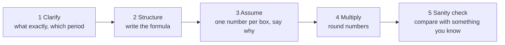

# Ads guesstimate drills (with worked answers)
*Every input below is an **assumption for practice**, not a real Swiggy number. In the interview the
interviewer cares about your structure and your sanity checks, not the exact digits.*

## The 5-step routine (say these steps out loud)

**Golden rule:** say the formula *before* any number. "Revenue = orders × share of orders that see the ad × click rate × price per click." Then fill it.

Hinglish tip: *Pehle formula bolo, phir numbers. Numbers galat ho sakte hain, formula galat nahi hona chahiye.*

---

## Drill 1 · How much could sponsored listings earn in one city per month?

**Clarify:** one large Indian city, restaurant "sponsored" slots in the listing, pay-per-click, one month.

**Formula:**
`Revenue = app sessions × sponsored slots seen per session × CTR × cost per click`

| Box | Assumption | Why |
|---|---|---|
| Monthly ordering users in the city | 2 million | big metro, a fraction of the population orders online |
| Sessions per user per month | 8 | a couple of browses per week |
| Sessions | 16 million | 2M × 8 |
| Sponsored slots seen per session | 3 | first screen usually shows a few |
| Sponsored impressions | 48 million | 16M × 3 |
| CTR on a sponsored slot | 2% | higher than display ads because users are already hungry and browsing |
| Clicks | 0.96 million | 48M × 2% |
| Cost per click | ₹5 (assumption) | small restaurant budgets |
| **Revenue** | **≈ ₹48 lakh per month** | 0.96M × ₹5 = ₹4.8M = ₹48 lakh |

**Sanity check:** per ordering user that's about ₹2.4 a month (₹48 lakh ÷ 2M users). That's small next to the commission on even one order, so either sponsored listings are a minor line, or my CTR/CPC/slots assumptions are low. Say that out loud: the sanity check is where you question your own inputs.

**Unit trap (I made this mistake while writing this drill):** 1 million = 10 lakh, 1 crore = 10 million. ₹4.8 million is ₹48 lakh, not ₹4.8 crore. Convert slowly and say the units.

**What moves it most:** CTR and cost per click. Say: "If CTR is 1% instead of 2%, revenue halves, so I'd check CTR first in the real data."

**Link to my project:** this is the same chain as my KPI layer (impressions → CTR → CPC → revenue). In my data, CTR and CPC were computed from totals, never averaged.

---

## Drill 2 · Should we add a banner on the order-tracking screen?

**Clarify:** new ad format, shown while users wait for delivery. Question = incremental revenue, and what could go wrong.

**Formula:**
`Incremental revenue = orders × share who open tracking × banner views per order × CPM ÷ 1,000 − cannibalisation`

| Box | Assumption | Why |
|---|---|---|
| Orders per day (one city) | 300,000 | assumption |
| Share who open the tracking screen | 70% | most people check where the food is |
| Banner views per order | 3 | they check a few times |
| Daily banner impressions | 630,000 | 300K × 70% × 3 |
| CPM (brand ads, not restaurants) | ₹80 (assumption) | brand display rates |
| Gross daily revenue | ≈ ₹50,400 | 630K × ₹80 ÷ 1,000 |
| Cannibalisation | 10% | some brands move budget from other slots |
| **Incremental per month** | **≈ ₹13.6 lakh** | ₹50,400 × 0.9 × 30 |

**Guardrails I would watch (this is where you stand out):** order cancellations, app rating, support tickets about "too many ads", time to reorder. Same idea as the visit guardrail in my A/B test.

**Recommendation:** A/B test it. Primary metric = ad revenue per order; guardrail = repeat-order rate must not fall. Decide the rule *before* the test (like my EXPERIMENT.md).

---

## Drill 3 · We raise the minimum cost per click by 10%. What happens to revenue?

**Clarify:** pricing change on existing inventory. Short-term vs long-term.

**Formula:**
`New revenue = clicks that still happen × new price`
`= clicks × (1 − share lost) × price × 1.10`

**Break-even (the key move):** revenue stays flat if `(1 − share lost) × 1.10 = 1`, so **share lost = 1 − 1/1.10 ≈ 9.1%**.

So: "A 10% price rise pays off only if we lose fewer than about 9% of clicks." You don't need to know the true number to give a useful answer. You turn the unknown into a test target.

**Link to my project:** this is exactly my floor-price model. At a 30-fen minimum floor the break-even was about half of at-risk impressions still selling. Same logic, different numbers.

**What I'd add:** advertisers with thin margins (high CPA, my "fix" group) leave first. So check which segment the lost clicks come from, not just how many.

---

## Practice routine
1. Cover the tables. Do each drill out loud in under 4 minutes with a timer.
2. Change one assumption (CTR, price) and say how the answer moves.
3. Always end with: the number, the biggest uncertainty, and how you'd measure it.
